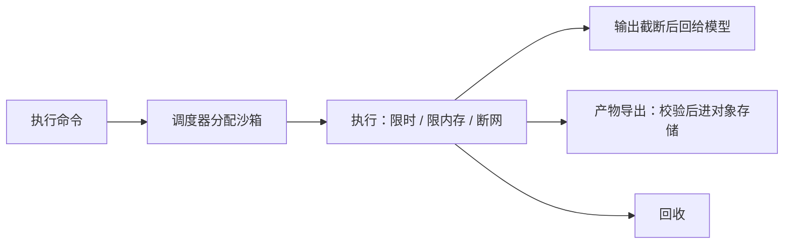

## 一句话定位

- **沙箱**：给 agent 执行代码 / 命令的隔离环境。管两件事 —— 能不能跑、跑坏了伤不伤宿主。
- 定位是**信任边界**：模型生成的命令，默认按不可信代码对待。

## 要不要用

- 判断线：**有没有「不可信代码在跑」**。有就得上，没有只是加成本。
- 要用：用户能填命令 / 贴代码 / 传脚本；模型自己写代码再跑（分析、画图、跑测试、装依赖）；处理上传的压缩包、第三方仓库；长任务跑完要整块丢掉。
- 不用：只调 API 拼回复的问答 agent；参数有 schema 的固定工具（查订单、查天气，风险在参数校验）；内部可信的一次性批处理。

风险就四类，沙箱是照着这四类设防：

- 读：`~/.ssh`、`.env`、云凭据
- 写：改源码、删数据、覆盖配置
- 外联：把读到的内容传出去
- 耗尽：死循环、OOM、写满磁盘

顺带一层价值：环境可复现，依赖与系统库钉在镜像里，跑完即弃。

## 隔离强度

| 做法 | 边界 | 启动 | 场景 |
|---|---|---|---|
| 宿主进程 / 本机目录 | 无，只是限制工作目录 | 0 | 本地实验 |
| 容器（Docker / runc） | 命名空间隔离，**共享宿主内核** | 百毫秒 | 产品起步 |
| microVM（Firecracker / Kata） | 独立内核 | 百毫秒～秒 | 多租户、跑不可信代码 |
| 用户态内核（gVisor） | 拦系统调用，兼容性有代价 | 百毫秒 | 折中 |
| 托管沙箱（E2B / Daytona / Modal） | 厂商负责，通常 microVM | 秒级 | 不想运维 |

线：**共享内核 = 逃逸一次就到底**。允许上传任意代码时，容器不够。

## 怎么实现

| 路线 | 怎么做 | 代价 |
|---|---|---|
| 本机子进程 | `spawn` + 临时 `cwd` + `timeout` / `maxBuffer` | 零隔离，只挡误操作 |
| 自建容器 | 镜像预装依赖 → 每会话一个容器 → 挂工作目录 → 网络策略 → 定时回收 | 要运维镜像、调度、配额 |
| 托管 SDK | create → upload → run → collect → destroy | 按秒计费、依赖外部服务 |

三条路线形状一样：

```text
create()                                    // 镜像 / 配额 / 网络策略
upload(files)                               // 送文件进去，校验类型与大小
run(cmd, { timeout, maxOutputBytes, env })  // 限时限输出
collect(paths)                              // 只取声明的产物，校验路径前缀
destroy()                                   // 必回收
```

自建还是买：数据不能出内网、要接内部依赖 → 自建容器；要强隔离又没人运维 → 托管 microVM。

## 五个必须配的边界

1. 时间：命令级 `timeout` + 会话总时长；杀进程组，不只杀 shell。
2. 资源：CPU / 内存 / 磁盘配额，一个 `while true` 就能拖垮机器。
3. 输出：字节上限截断，`ls -R /` 能把上下文塞爆。
4. 环境变量：白名单 `PATH`、`HOME`，不继承整个 `process.env`，尤其不能带模型 Key。
5. 网络：默认关出站，或只放域名白名单。

## 生命周期

- 粒度：每会话一个（默认）/ 每命令一个（最干净最贵）/ 每用户一个（省启动，残留状态会串）。
- 谁创建、谁复用、谁回收要有人管，失败路径也要回收。
- 冷启动：依赖进镜像 + 预热池，比运行时 `npm i` 快一个数量级。



## 产物怎么带出来

- 沙箱是临时的，产物必须显式导出。
- 导出三件事：`realpath` 解析后校验前缀仍在沙箱内；大小上限 + 类型白名单；对象存储按 `user / project` 分前缀。
- 反向同样要管：传进去的文件也要校验，别让人上传脚本再让它跑。

## 常见坑

- 把「工作目录受限」当隔离：文件工具被限制，命令照样 `cat /etc/hosts`。
- 交互式命令卡死：`vim`、`top` 没有 PTY 会一直挂着，禁掉或强制超时。
- 沙箱和宿主共用一个目录：宿主的 `rm -rf` 直接没，卷要只读或干脆不挂。
- 按字节截断切坏 UTF-8，回给模型的是乱码。

## 面试三问

- **执行用户代码怎么保证安全**：隔离（容器 / microVM）→ 资源与时间限制 → 断网 → 危险操作审批 → 产物导出校验。只说「用了 Docker」不完整。
- **容器还是 microVM**：看威胁模型，内部可信容器够，允许上传任意代码要独立内核。
- **产物怎么持久化**：显式导出 + 路径校验 + 对象存储按租户分区 + 元数据入库。
