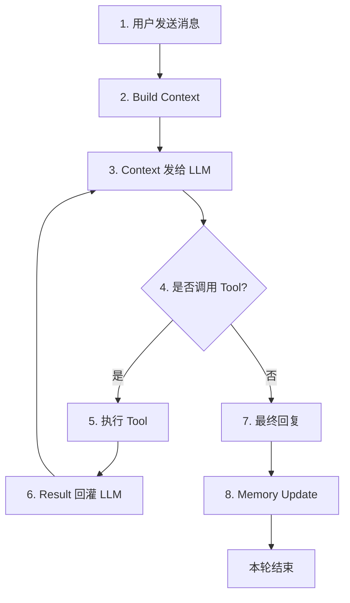
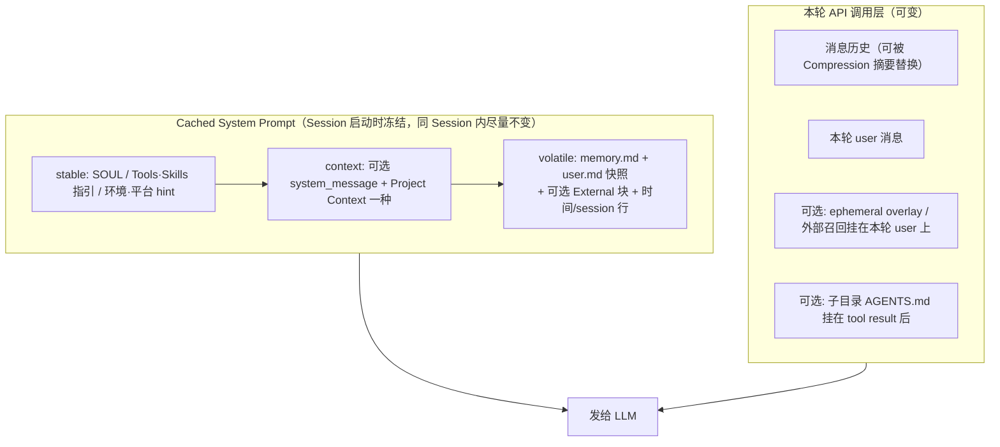

## 1、基本介绍

- 是什么？一个类似 openclaw 这种个人助理的东西
- 内置了很多 Geteway（链接两种不同网络协议之间的节点）和各种常用的插件

---

## 2、循环步骤



### 2.1、如何 Build Context（分层构建 + 拼接）



#### 部分含义解释

**冻结快照模式：** 系统 prompt 注入在会话开始时捕获一次，会话中途不会改变。这是有意为之——目的是保留 LLM 的前缀缓存以提升性能。当 Agent 在会话期间添加或删除记忆条目时，更改会立即持久化到磁盘，但要到下一次会话开始时才会出现在系统 prompt 中。工具响应始终显示实时状态。

何时恢复：会话恢复、新会话、上下文压缩、模型切换（provider 的缓存空间 / 机制都不同）

- **soul**：你自己设定的 agent 身份 / 人格 / 行为准则
- **system_message**：调用方传入的基本信息和行为准则（cli / 网页前端、外部程序调用 - python 脚本、外部 agent、父调用子 agent、切换模型）
- **project content**：/hermes.md、Agents.md...
- **externa**：外部的长期记忆
- **ephemer overlay**：(临时指令，本质是在 system 尾部添加一段非冻结的提示词)
    - 改人格（不影响 soul，内置了 /personality 指令 14 种人格）
    - 改环境变量
    - 子 agnet 委派（父 agent 委派了什么任务，和冻结的 sp 是分开的）
- **外部召回**：搜索 / api 数据 / 程序获取
- **tool_reult**：上轮工具调用结果，openai 有独立的 role=tool，其他的拼接到 role=user 后
- **子目录 Agents.md**：调用什么工具，该工具的 md 文档会拼接到 tool result 后
- **知识库获取方式**：请求前自动获取（归属外部召回）、走 tool 工具（归属 tool_reult）

---

### 2.2、压缩机制

1. 如何预测？用 API 返回的真实 token 用量（不是估算）
2. prompt_tokens（本次请求的总输入 token）≥ 50% × 模型 context_length → 触发
3. 保护前 3 轮（system prompt、最初的请求、第一次回答）
4. 保护最后 N 轮（默认 20 条消息 ≈ 10 轮）
5. 中间的轮次用便宜快的模型摘要
6. 摘要作为一条 user 消息插入，对话无缝继续

#### 摘要长什么样？

一段结构化 markdown，开头声明"仅作背景，只响应之后的新消息"。区块：目标 / 约束 / 已完成（带日期）/ 进行中 / 阻塞 / 关键决策 / 相关文件 / 下一步。每条一两行，只保留有价值的结论。二次压缩是更新上一份，不是重写。

---

### 2.3、Memory

https://hermes-agent.nousresearch.com/docs/zh-Hans/user-guide/features/memory

**特点**

- 有效信息：只记忆紧凑、信息密度高的信息
- 重复防护：记忆系统会自动拒绝完全重复的条目
- 安全扫描：记忆被接受之前会扫描注入和数据外泄模式，防止被注入系统 prompt
- 外部记忆：对于超出 MEMORY.md 和 USER.md 范围的更深层持久化记忆，Hermes 内置了 8 个外部记忆提供商插件，外部提供商与内置记忆**并行**运行（而非替代）

**Memory由三部分组成**

1. **内置记忆文件**（用于 system prompt，存储时机：触发 memory 工具 / turn 结尾）

   每次对话结束（Turn），会进行 memory update，Agent 会自动更新以下信息：

    - memory.md（环境、工具、项目约束...）
    - user.md（用户信息与偏好）
    - soul.md（用户对 agnet 的设定，行为准则规范）

2. **SQLite**（关系型数据库，存对话数据，存储时机：多个时机，增量存储：游标 + 增量，用于会话恢复和跨会话检索）

    **存什么？**

    - 聊天记录
    - 会话元数据（session_id / session_key / 标题、时间戳、profile、token 用量）
    - 本 turn 对话的完整 system prompt
    - **FTS5 全文索引**（作用：让历史对话变成"可搜索"，同时不占常驻上下文）
        - 非向量检索，FTS5 = SQLite 自带的全文检索扩展（Full-Text Search 5）
        - "虚表"：查询时看起来像一张表，能 `WHERE content MATCH '关键词'`，但底层是倒排索引（词 → 命中哪些行），所以查关键词快，不用逐行扫
        - Hermes 把每轮消息文本写进去 → session_search 就靠它（使用二元分词）

    **触发时机？**

    - 消息落库（用户输入 / 每次工具轮 / turn 收尾 flush）
    - 消息被删 / 被压缩归档 → 触发器同步删除对应索引行
    - 启动时：索引是否 stale（比如分词器能力变化）

    **二元分词**

    - **Hermes 专门加载 cjk_unicode61（SQLite FTS5 的 unicode61 分词器 + 中文二元切分）**
    - 二元分词（bigram）就是绕开词典的做法：不判断词，机械地每两个字切一刀：
        - 今天天气不错 → 今天 / 天天 / 天气 / 气不 / 不错
        - 搜索时查询也切一遍：查 天气 → 切成 天气 → 能对上
    - 代价：索引膨胀，精度略差但召回好

3. **External Memory**（外部的记忆，与内置记忆叠加，官方有提供 / 也可自己实现 provider）

---

## 3、部分内置工具

### 3.1、todo_list（任务清单）

**任务复杂或者多步的时候，先列一个 todo 清单，再一步步做。**

- 这只是"建议"，不是强制：靠系统提示 + 工具说明劝模型先规划，列不列由模型自己决定。
- 一个工具两用：给 todos 就是写 / 更新清单，不给就是看当前清单。
- 清单存在会话内存里，也不塞进 system prompt，所以不会拖慢响应（保住缓存）。
- 上下文被压缩时，没做完的 todo 会被重新放回上下文，模型不会忘了要干嘛。

### 3.2、session_search（跨会话检索）

**能搜索你以前所有的对话，不只当前这一次。**

- 一个工具靠参数自动分模式：给关键词=搜，给 session_id=读那一段，什么都不给=列会话。
- 排序会把定时任务、子 agent 产生的对话降权或隐藏，免得搜出来全是机器人的废话，你真正聊的被埋掉。
- 每条消息有长度上限，防止一条超长的工具结果把 token 撑爆。

### 3.3、clarify（中途问用户）

**模型拿不准时，可以停下来给你弹选择题，而不是瞎猜。**

- 最多 4 个选项，界面永远多给一个"其他（自己填）"。
- 第一个选项自动标 "(Recommended)"；但你选完回传给模型的答案里会把这个标签去掉（它只是给你看的）。

### 3.4、execute_code（写脚本一次调多个工具）

**让模型写一段 Python脚本（本工具参数），在脚本里连续调好几个工具，最后只把 print 出来的结果拿回来。**

- 什么时候用：需要连调 3 个以上工具，中间还要做判断 / 循环 / 过滤的时候。
- 好处：本来要来回好几轮（调工具 → 看结果 → 再调），现在一轮搞定，而且中间结果不进上下文。
- 脚本跑在一个常驻的解释器里；输出太长会自动存成文件，只给路径 + 头尾预览，需要时再去读。
- 场景：比如要读10个文件内容，不可能每次都把文件内容又塞回tool_result然后继续下一轮

### 3.5、tool_search / tool_describe / tool_call（三个"桥接工具"：按需加载工具）

**工具太多时，不把所有工具的说明一股脑塞给模型，而是先"搜工具"，用到哪个再加载哪个。**

- 平时不出现；只有挂了很多 MCP / 插件工具时，Hermes 才把它们收起来，换成这三个工具按需查。
- 用法：tool_search 搜 → tool_describe 拿用法 → tool_call 执行。
- 搜索是关键词匹配（BM25），做了英文词干，所以 issues 能匹配到 create_issue。
```
	模型调 tool_search("我想干的事") → 
	拿回可能的工具名 tool_describe(那些名字) → 
	拿回这个工具怎么传参 tool_call(名字, 参数) → 
	Hermes 按这个名字去真正执行
```

### 3.6、delegate_task（子 agent）

**把一个任务丢给另一个独立上下文的子 agent 去做，只有它的最终总结会回到主 agent。**

- 怎么触发：主 agent 自己调这个工具——Hermes 里"派子 agent"就这一个入口。
- 派出去后立刻拿回一个 id，你和主 agent 都能接着干别的，不用干等。
- 派出去时就已经有一条状态 running 的**记录**（内存 + 落库），所以"还在不在跑"是查记录，不是去问子 agent。
- 跑完时 Hermes **新造一个"完成事件"**：先落库，再塞进一个**全局共享队列**；CLI / 网关在**每轮 turn 收尾时**清这个队列，把"结果 + 当初派它的目标"作为一条**合成的 user 消息**注入会话 → 开新 turn。所以看起来像模型"自己又开口了"，**不是界面提示，也不是模型去轮询**。
- 注入的那条消息里还会提醒模型："你可能已经不需要了，自己判断用不用 / 重派"。
- 子agent下派，默认一层，多层要修改参数 max_spawn_depth
- 如何调用？
  **派发**：传 `tasks=[{goal, context}]`，不写 `action`（数组一个元素 = 一个子 agent）。
  **其他操作**：`action="list"` 看进度、`action="steer"` 追加纠偏、`action="stop"` 停掉；`/new` 或关会话会把整棵子 agent 杀掉。

### 3.7、文件工具（防止乱改）

**模型改一个已存在的文件之前，必须先读过它，否则不许覆盖。**

- 就是防模型凭印象瞎改。
- 同一个文件、同一版本重复读，第二次只返回一句提示（省 token）；但上下文压缩后会清空，保证压缩后重读还能拿到全文。

---

## 4、Eval评估测试

先分清两个目录 —— 它们不是一个东西：

| | `tests/`（全量测试） | `evals/`（评测） |
|---|---|---|
| 是什么 | 940 个 pytest 文件 | 70 个场景 |
| 调不调模型 | 不调 | 调 |
| 结果 | 确定，跑十次一样 | 有波动 |
| 开销 | 秒级，不花钱 | 分钟级，花 API 费 |
| 什么时候跑 | 本地提交前 + 发版 CI 自动 | **手动**，改关键逻辑时跑 |

### 4.1、`tests/`：契约测试（自动跑）

| 测什么         | 怎么判断                                | 调模型 |
| ----------- | ----------------------------------- | --- |
| 消息结构        | 同 role 不能连发；tool_call 后面必须跟 tool 结果 | 否   |
| 上下文压缩       | 前几轮 / 最近 20 条有没有被保护；摘要拼回去 role 不冲突  | 否   |
| 工具调用        | 参数类型能不能转、批量怎么分段、被截断怎么收尾             | 否   |
| 预算步数        | 到上限就退出；扣减数与 api_calls 对得上           | 否   |
| 记账成本        | 输入 / 输出分开算；缓存命中价差算对                 | 否   |
| 持久化恢复       | 中断后能恢复；恢复后 role 仍合法                 | 否   |
| provider 差异 | cache 标记打在哪；不支持的参数怎么降级              | 否   |
| 记忆          | provider 读写位置；压缩后不重复注入              | 否   |

### 4.2、`evals/`：回放评测（手动跑，真调模型）

#### 4.2.1、压缩评测 —— 评分（`evals/compaction/`）

1. 准备：一份很长、很完整的聊天记录（json，没压过的）
2. 抽题：只从“会被压掉的那段”出 15 道事实题 + 标准答案，缓存
3. 压：脚本读这份记录 → 自己压一遍 → 得到“压过的版本”
4. 答：同一批问题，只看“压过的版本”能不能答出来
5. 判：judge 拿标准答案打分（2 对 / 1 部分对 / 0 错）
6. 对照：再跑一遍不压缩的 → 分数差 = 压缩丢了什么

产出：召回率 vs 保留 token，用来选压缩策略。

#### 4.2.2、工具选择评测 —— 契约（`evals/tool_search/`）

1. 准备：代码里手写死 5 个任务（一句 prompt + 该调哪些工具），**不需要历史对话**
2. 跑：tool_search 开 / 关各跑一遍
3. 看：该调的底层工具有没有调到（`expected_underlying_tools`）

不判回答写得好不好，只判“选对工具没有”。

### 4.3、什么时候跑

| 时机         | 跑什么                                          | 谁触发 / 在哪                           |
| ---------- | -------------------------------------------- | ---------------------------------- |
| 写完代码       | `scripts/run_tests.sh`：不传路径 = 全量；传路径 = 只跑那部分 | 人手动，本地                             |
| 提 PR       | 按改动挑 lane（**增量**）                            | CI 自动，见 4.4                        |
| 合进 main    | 全部 lane（**全量**）                              | CI 自动，见 4.4                        |
| 发版         | 全量 `tests/`                                  | `stable-release.yml` 自动调 `ci.yaml` |
| 打 tag `v*` | 真实 provider 的 live 测试                        | 自动（便宜模型、有美元上限）                     |
| 改压缩 / 工具选择 | `evals/` 对应场景                                | 人手动                                |

“空 diff / 改 `.github/` 就全开”只发生在 **CI**：`classify_changes.py` 拿不到改动列表（API 失败、没有 base），或这次改动包含 CI 配置本身 → 所有 lane 全开，防止“判断失效”变成“漏测”。

本地不受影响：本地跑多少由 `run_tests.sh` 后面跟的路径决定，不跟就是全量。

### 4.4、增量 vs 全量

PR 阶段是**增量**：`scripts/ci/classify_changes.py` 读改了哪些文件，决定开哪几个 lane。

| lane | 什么时候开 |
|---|---|
| `python` | 改了 `.py` 就开（denylist：只有全是文档 / 纯前端才跳过） |
| `docker` / `nix` | 改了 Dockerfile / flake / 依赖清单 |
| `frontend` | 改了 TS / 桌面端 |
| `deps` / `uv_lock` / `npm_lock` | 改了 `pyproject.toml` / `uv.lock` / `package-lock.json` |
| `scan` | 改了 Python、`.pth`、setup hook |
| `e2e` 系列 | **PR 上强制关**，只在发版或手动触发时开 |

三条铁律：

1. **fail open**：宁可多跑一个 lane，绝不漏跑可能被改坏的
2. 空 diff、或改了 `.github/` → 所有 lane 全开
3. push 到 main → 所有 lane 全开（没有 diff 可比）

所以：**增量只发生在 PR 阶段，合进 main 后一律全量。**

### 4.5、三层落点

| 层   | 在哪                          | 测什么                                  | 调模型 | 谁跑           |
| --- | --------------------------- | ------------------------------------ | --- | ------------ |
| 单元层 | `tests/agent/`              | 数据 / 结构对不对（快、结果确定）                   | 否   | 本地手动 + CI 自动 |
| 回放层 | `evals/`                    | 准备对话素材，查看结果对不对，只限好观测答案的点（如工具调用、事实问题） | 是   | **只有手动**     |
| 线上层 | `agent.log` / `gateway.log` | 真实表现，出事后回溯                           | 已在跑 | 系统自动记，人按需看   |

一句话：**单元层进 CI，回放层永远手动，线上层只记录不判定。**


## 5、定时任务Cron

调度器：每隔几十秒扫一次 job 列表，而不是为每个 job 设置定时器

两个必须处理的点：

**① 先改 next_run_at，再执行**
- 先执行再改时间：跑到一半进程崩了，时间还停在原地 → 重启后又跑一遍，重复
- 先改再执行：崩了最多漏一次，不会重复
- 取舍：宁可少跑，不可重复 —— 发消息、扣钱、提交代码，重复的代价更大

**② 加锁，防两个进程同时 tick**
一台机器上可能同时开着 gateway 常驻服务、CLI、桌面端，都读同一个 `jobs.json`。
- 没锁：两个进程同时扫到同一条任务，各自执行一遍 → 消息发两条
- 有锁：`<home>/cron/.tick.lock`，谁抢到谁 tick，另一个这轮直接跳过

```
job = {
  "id": "daily-report",
  "schedule": "0 9 * * *",     ← 规则（怎么算下次）
  "next_run_at": "2026-10-19T09:00:00Z",   ← tick 拿它和现在比
  "enabled": true,
  "prompt": "...",
  "delivery": {...}
}
```

---

## 6、多 Agent（Kanban）

**先认名词**

| 词 | 是什么 |
|---|---|
| Kanban | 日语「看板」，Trello 那种板：卡片在「待办 / 进行中 / 完成」之间移动 |
| 卡片（task） | 一条任务：做什么、分给谁 |
| worker | 真正干活的 agent 实例，按 profile 区分 |
| dispatcher | 派活的人：定期扫板，把待办的卡分给空闲 worker |
| claim（领取） | worker 抢下卡片，别人就不能再抢 |

**和 delegate_task 的区别**

| | delegate_task | Kanban |
|---|---|---|
| 怎么派 | 主 agent 当场叫、等结果 | 挂在板上，worker 自己领 |
| 进程挂了 | 任务没了 | 进度在 SQLite，重启还能续 |
| 审批 | 没有 | 有 review，人批了才算完 |

**核心流程**

```
① 建卡：kanban_create → 卡片进「待办」
② dispatcher 定期扫板（默认 60 秒）：
     回收过期 claim → 挑出待办的卡 → 原子领取 → 拉起对应 profile 的 worker
③ worker 干活，中途 kanban_heartbeat 报到（证明自己还活着）
④ 结束：kanban_complete 完成 / kanban_block 卡住 / kanban_request_review 请人看
⑤ 人批：通过就归档；request_changes 打回重做
```

**卡片会经历的状态**

```
待办 → 已领取 → 完成
          ↓
        卡住（unblock 后回待办）
          ↓
       待评审 → 通过 / 打回
```

**三个关键设计**

- **原子领取**：靠 SQLite 事务抢卡，两个 worker 不会抢到同一张
- **过期回收**：worker 挂了没心跳，claim 会被回收，卡回到待办，不会永远卡死
- **默认跑在 gateway 里**（`kanban.dispatch_in_gateway: true`），也可以拆成独立 systemd 服务

**注意**：这套工具默认是关的，要 `hermes tools enable kanban --platform <p>` 才会给 worker 配上。
