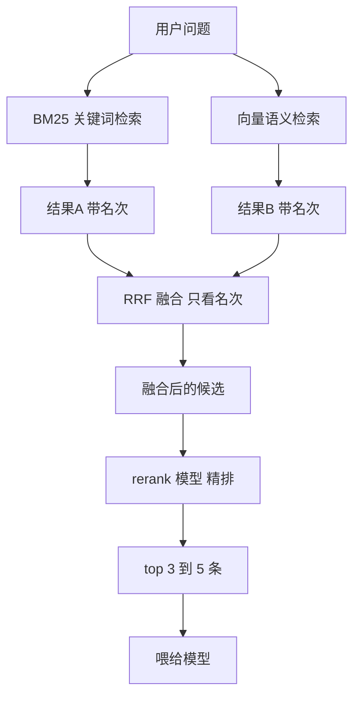

- 会话记忆
- 结构性文档
- 跨会话检索
   关键词：分词器 + BM25 
     **BM25**: (关键词搜索排序公式，关键词 + 权重，关键词出现次数越多分数越高 )
   语义检索: 向量化 + 召回
   混合检索: （BM25检索/向量检索） + RRF + 重排(rerank模型)
     **RRF**：同一篇文章的两个名次换算成分数，两路相加，取分数高的n条(通常两路都有检索命中，分数会更高)
     **重排**：把n条候选，一条条拿去让一个专门的小模型判断"这段跟问题到底多相关"，按它的分数重新排队，只留下最相关的几条。（rerank模型分llm和针对性的模型，针对性模型速度更快，llm更准更慢更贵要求高且量少可用-复杂推理）

