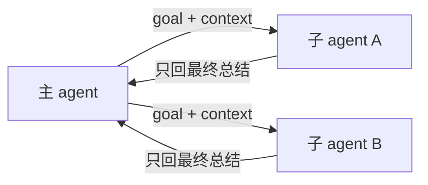

- 是什么：父 agent 派出去的一个临时 agent，跑全新对话，只把最终总结交回来

- 输入：
  goal（要干什么）+ context（背景 / 约束 / 已知信息）
  system prompt 是围绕 goal + context 现搭的
  规则文件（AGENTS.md → CLAUDE.md 等）

- 输出：只返回处理结果或失败信息

- 工具：继承父的，但砍掉三类
  派子 agent / 问用户 / 写长期记忆

- 派发方式
  同步：原地等结果
  异步：立刻返回一个 id，跑完结果作为一条新消息回来

- 并发：一次可派多个并行；每个子 agent 有独立步数上限

